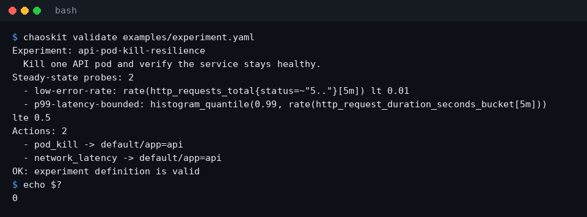
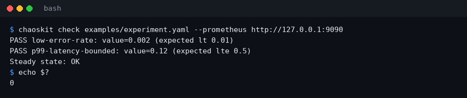
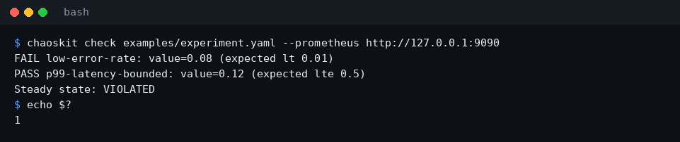
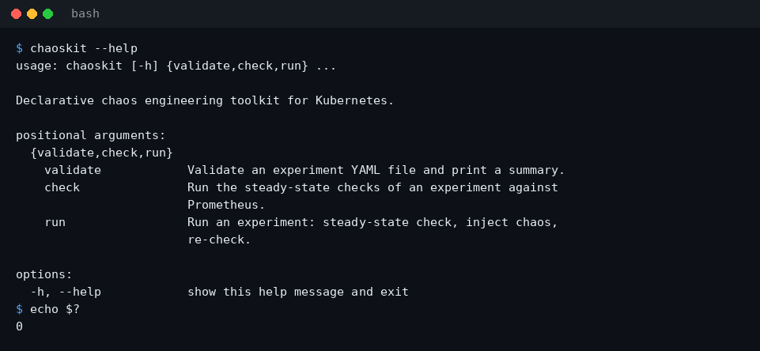
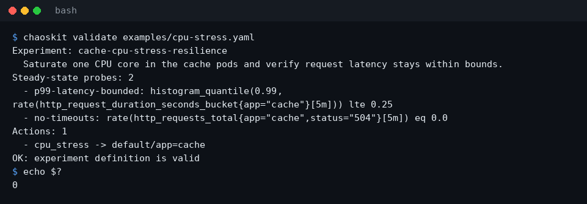
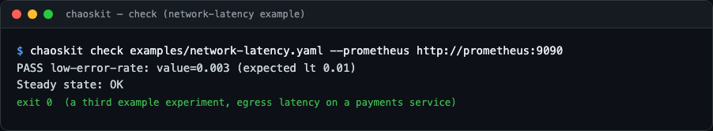

# chaos-kit

[](https://github.com/tenalisriharsha/chaos-kit/actions/workflows/ci.yml) [](LICENSE)

A declarative chaos engineering toolkit for Kubernetes.

Define resilience experiments in YAML — pod kills, CPU stress, network
latency — and chaos-kit injects them, verifies your steady-state hypothesis
against Prometheus before and after, and produces a pass/fail resilience
report.

## Preview

Real CLI output, captured by [docs/screenshots/generate.py](docs/screenshots/generate.py),
which runs each command shown and draws its output verbatim. The `check`
and `run` views run against a stub Prometheus that the script serves on
`127.0.0.1:9090` (the same pattern the test suite uses), not a live one.
The `run` views run against a real k3s cluster, set up as described in
[docs/real-cluster.md](docs/real-cluster.md):



<details>
<summary>More views</summary>












</details>

## Experiment format

```yaml
name: api-pod-kill-resilience
description: Kill one API pod and verify the service stays healthy.

steady_state:
  - name: low-error-rate
    query: rate(http_requests_total{status=~"5.."}[5m])
    operator: lt
    threshold: 0.01

actions:
  - type: pod_kill
    target:
      namespace: default
      label_selector: app=api
    params:
      count: 1
```

See [examples/experiment.yaml](examples/experiment.yaml) for a full
example. More ready-to-adapt experiments live in the
[examples gallery](examples/):

- [examples/experiment.yaml](examples/experiment.yaml) — pod kill plus
  network latency against an API service
- [examples/pod-kill.yaml](examples/pod-kill.yaml) — a single pod kill
  (the experiment shown above)
- [examples/cpu-stress.yaml](examples/cpu-stress.yaml) — CPU saturation
  on cache pods
- [examples/network-latency.yaml](examples/network-latency.yaml) —
  egress latency on a payments service

## Usage

```bash
# Validate an experiment definition
chaoskit validate examples/experiment.yaml

# Check the steady-state hypothesis against Prometheus
chaoskit check examples/experiment.yaml --prometheus http://localhost:9090

# Run the full experiment: steady-state check, inject chaos, settle, re-check
chaoskit run examples/experiment.yaml --prometheus http://localhost:9090

# Same, but emit the resilience report as JSON
chaoskit run examples/experiment.yaml --prometheus http://localhost:9090 --json
```

## Resilience reports

`chaoskit run` ends with a pass/fail resilience report covering the
verdict, pre/post steady-state probes, every injected action, and
wall-clock timing (total duration and recovery time). Example (pod names
and timings are illustrative):

```
chaos-kit resilience report
===========================
Experiment: api-pod-kill-resilience
  Kill one API pod and verify the service stays healthy.
Started:  2026-08-11T08:07:18Z
Duration: 10.42s (recovery: 10.02s)

Pre-injection steady state:
  PASS low-error-rate: value=0.001 (expected lt 0.01)
  PASS p99-latency-bounded: value=0.12 (expected lte 0.5)

Injected chaos:
  - pod_kill -> default/app=api: deleted 1 pod(s): api-6d9f8c7b5-x2abc (at 2026-08-11T08:07:18Z)
  - network_latency -> default/app=api: added 100ms latency for 30s in 1 pod(s): api-6d9f8c7b5-y7def (at 2026-08-11T08:07:19Z)

Post-injection steady state:
  PASS low-error-rate: value=0.002 (expected lt 0.01)
  PASS p99-latency-bounded: value=0.15 (expected lte 0.5)

Verdict: experiment PASSED
```

With `--json` the same report is emitted as machine-readable JSON
(verdict, probe values, injections, and timings) for CI pipelines and
dashboards. Exit codes: `0` passed, `1` failed or aborted, `2`
setup/validation error.

## Chaos actions

| Action | Effect | Params (defaults) |
| --- | --- | --- |
| `pod_kill` | Deletes pods matching the target selector | `count` (1) |
| `cpu_stress` | Runs `stress-ng` inside matching pods | `cores` (1), `duration` (30s) |
| `network_latency` | Adds egress latency via `tc`/netem, self-cleaning | `latency_ms` (100), `duration` (30s) |

Actions target pods via `target.namespace` and `target.label_selector`.
`cpu_stress` needs `sh` and `stress-ng` in the container image;
`network_latency` needs `sh`, `tc` (iproute2), the `NET_ADMIN` capability
and a node kernel with netem (`sch_netem`). If any of these is missing the
run stops with an `ERROR` naming the pod and the command's output, and
exits `2`. Both run detached in the pods and end on their own after
`duration`. Only pods that are `Running` and not terminating are
targeted.

`chaoskit run` requires a kubeconfig (or in-cluster config) and the optional
`kubernetes` Python package (`pip install kubernetes`). It verifies the
steady-state hypothesis first and aborts without injecting anything if the
system is already unhealthy.

## Development

```bash
python3 -m venv .venv
.venv/bin/pip install -e ".[dev]"
.venv/bin/python -m pytest
```

## Status

**Feature-complete for the planned scope (phases 1-3).**
See [PROGRESS.md](PROGRESS.md) for the vision, architecture and phased build
plan.

Current state: **Phase 3 complete** — experiment schema, steady-state
verification against Prometheus, Kubernetes chaos injectors (`pod_kill`,
`cpu_stress`, `network_latency`), an experiment runner, pass/fail
resilience reports (text and JSON), and a CLI (`validate`, `check`,
`run`). The suite covers every module, using a stub Prometheus and a fake
Kubernetes client.

`chaoskit run` has been run against one real cluster (single-node k3s, see
[docs/real-cluster.md](docs/real-cluster.md) for exactly what was run):

- **Verified:** `pod_kill` deletes the matching pod and the Deployment
  replaces it; `cpu_stress` runs `stress-ng` in every matching pod at once
  while the post-check runs; the pre/post steady-state checks, the abort
  path, the text and JSON reports, and exit codes `0`/`1`/`2`; clear
  errors when `stress-ng`, `tc`, `NET_ADMIN` or kernel netem support is
  missing.
- **Not verified:** `network_latency` actually adding and then removing
  latency (that kernel has no netem); a real Prometheus (steady-state
  values were stubbed); multi-node clusters, other runtimes, in-cluster
  configuration and restricted RBAC.

## License

MIT, see [LICENSE](LICENSE).
