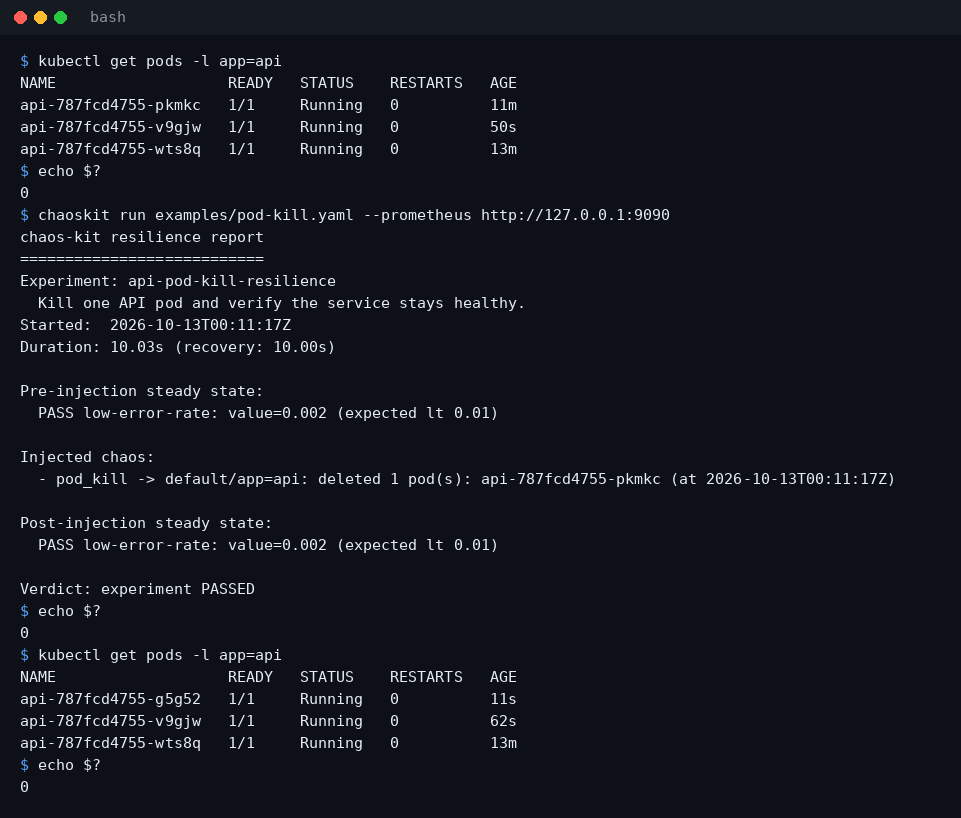
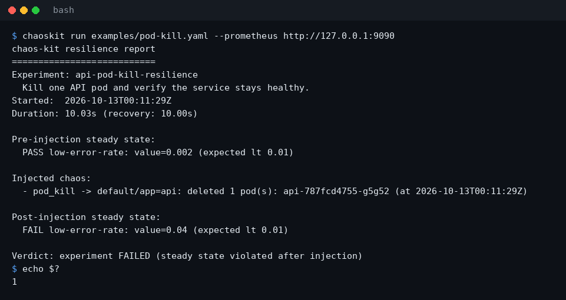
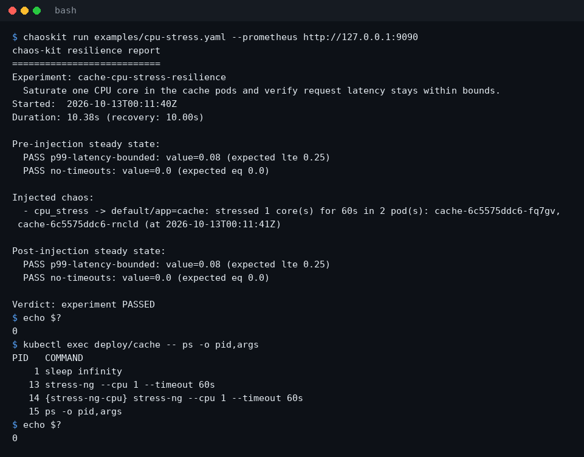
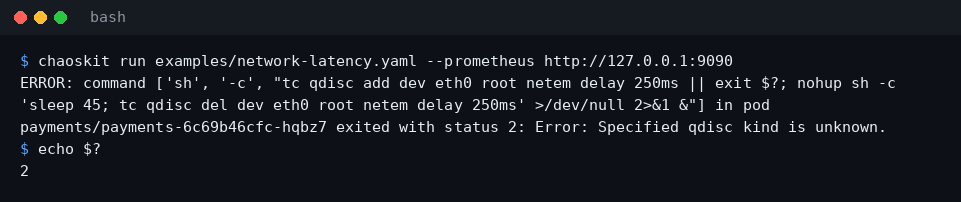
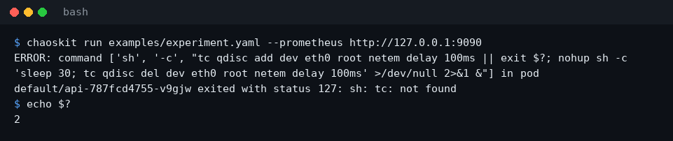

# Running chaos-kit against a real cluster

Until this verification, `chaoskit run` had only been exercised by unit
tests with a fake Kubernetes client. This page records the first run
against a real Kubernetes cluster: exactly what was run, what it showed,
the bugs it exposed (all fixed, each with a test), and what is still not
verified.

All outputs below are copied from the terminal unedited. The previews in
[screenshots/](screenshots/) (`07`-`11`) were produced by
`python docs/screenshots/generate.py --cluster`, which runs the commands
shown against the same cluster and draws their real output.

## Environment

| | |
| --- | --- |
| Cluster | k3s `v1.31.4+k3s1`, single node, Docker `29.8.2` as the container runtime (`k3s server --docker`) |
| Kernel | `6.18.44` (a VM; `CONFIG_NET_SCH_NETEM` is not set, no loadable modules) |
| chaos-kit | this branch, `pip install -e ".[dev]" kubernetes` on Python 3.13 |
| `kubernetes` package | `37.0.1` |
| Credentials | the k3s admin kubeconfig (`~/.kube/config`) |
| Prometheus | a stub HTTP server on `127.0.0.1` answering `/api/v1/query` with fixed values (see below) |

The sandbox this ran in needed some workarounds that are about the
sandbox, not about chaos-kit, and none of them are in this repository:
`kind` could not start pod sandboxes there, so k3s ran directly on the
host; a `runc` wrapper clamped negative `oom_score_adj` values to 0
(the VM kernel refuses them); the node IP was added to `NO_PROXY` so the
API server could reach the kubelet for `exec`/`logs`; kubelet image-GC and
eviction thresholds were relaxed so it would not delete local images; and
Docker pulled through `mirror.gcr.io` because Docker Hub rate-limited the
sandbox. A normal cluster needs none of this.

## Workloads

`api` (the target of `examples/experiment.yaml` and `examples/pod-kill.yaml`):

```bash
kubectl create deployment api --image=nginx:1.27-alpine --replicas=3
```

This creates three pods labelled `app=api` in `default`. The stock nginx
image has neither `tc` nor `stress-ng`.

`cache` (target of `examples/cpu-stress.yaml`) and `payments` (target of
`examples/network-latency.yaml`) use a local image with both tools, built
from `nicolaka/netshoot` (which has `tc`) plus the static `stress-ng`
binary from `alexeiled/stress-ng`:

```dockerfile
FROM mirror.gcr.io/nicolaka/netshoot:latest
COPY --from=mirror.gcr.io/alexeiled/stress-ng:latest /stress-ng /usr/local/bin/stress-ng
```

```yaml
apiVersion: apps/v1
kind: Deployment
metadata:
  name: cache
  namespace: default
spec:
  replicas: 2
  selector:
    matchLabels: {app: cache}
  template:
    metadata:
      labels: {app: cache}
    spec:
      containers:
        - name: cache
          image: chaos-target:local
          imagePullPolicy: Never
          command: ["sleep", "infinity"]
---
apiVersion: v1
kind: Namespace
metadata:
  name: payments
---
apiVersion: apps/v1
kind: Deployment
metadata:
  name: payments
  namespace: payments
spec:
  replicas: 2
  selector:
    matchLabels: {app: payments}
  template:
    metadata:
      labels: {app: payments}
    spec:
      containers:
        - name: payments
          image: chaos-target:local
          imagePullPolicy: Never
          command: ["sleep", "infinity"]
          securityContext:
            capabilities:
              add: ["NET_ADMIN"]
```

`cache` has `tc` but no `NET_ADMIN`; `payments` has both.

## Stub Prometheus

There was no real Prometheus and no real traffic, so the steady-state
values are stubbed: a small HTTP server answers every `/api/v1/query`
with a fixed value and logs each query (the same pattern as
`tests/conftest.py` and `docs/screenshots/generate.py`). This verifies
that chaos-kit queries before and after injection, with the right PromQL
and at the right times, and that it judges the values correctly. It does
not verify that a real service's metrics react to the injected fault.

Query log from the first run of `examples/experiment.yaml` (`--settle`
default of 10s), showing the pre-check, then the post-check 11s later:

```
23:59:36 query=rate(http_requests_total{status=~"5.."}[5m])
23:59:36 query=histogram_quantile(0.99, rate(http_request_duration_seconds_bucket[5m]))
23:59:47 query=rate(http_requests_total{status=~"5.."}[5m])
23:59:47 query=histogram_quantile(0.99, rate(http_request_duration_seconds_bucket[5m]))
```

## Results

### pod_kill: verified

`chaoskit run examples/pod-kill.yaml` deleted exactly one pod matching
`app=api` in `default`, the Deployment replaced it within the 10s settle
window, the post-check ran, and the run exited `0`. The `cache` and
`payments` pods were not touched (`kubectl get pods -A` before and after).



With the stub returning a violating value for the post-check only, the
same experiment reports `FAILED` and exits `1`:



`--json` on the real cluster (exit `0`):

```
{
  "experiment": {
    "name": "api-pod-kill-resilience",
    "description": "Kill one API pod and verify the service stays healthy."
  },
  "verdict": "passed",
  "passed": true,
  "started_at": 1791850226.528021,
  "finished_at": 1791850236.5556896,
  "duration_seconds": 10.027668476104736,
  "recovery_seconds": 10.001474142074585,
  "steady_state": {
    "pre": [
      {
        "name": "low-error-rate",
        "query": "rate(http_requests_total{status=~\"5..\"}[5m])",
        "operator": "lt",
        "threshold": 0.01,
        "value": 0.0,
        "passed": true
      }
    ],
    "post": [
      {
        "name": "low-error-rate",
        "query": "rate(http_requests_total{status=~\"5..\"}[5m])",
        "operator": "lt",
        "threshold": 0.01,
        "value": 0.0,
        "passed": true
      }
    ]
  },
  "injections": [
    {
      "type": "pod_kill",
      "target": "default/app=api",
      "description": "deleted 1 pod(s): api-787fcd4755-5gpnn",
      "at": 1791850226.5542026
    }
  ]
}
```

The abort path, with the stub returning a violating value for the
pre-check (`kubectl get pods -l app=api` listed the same three pods,
same ages, before and after):

```
$ chaoskit run examples/pod-kill.yaml --prometheus http://127.0.0.1:9093
chaos-kit resilience report
===========================
Experiment: api-pod-kill-resilience
  Kill one API pod and verify the service stays healthy.
Started:  2026-10-13T00:13:22Z
Duration: 0.00s (recovery: -)

Pre-injection steady state:
  FAIL low-error-rate: value=0.05 (expected lt 0.01)

Verdict: experiment ABORTED (steady state violated before injection)
$ echo $?
1
```

### cpu_stress: verified (after a fix)

With `stress-ng` in the image, `chaoskit run examples/cpu-stress.yaml`
starts `stress-ng --cpu 1 --timeout 60s` in both `cache` pods at the same
time and returns immediately; the post-check runs 10s later while both
pods are under load. `docker stats` at the moment the run finished showed
each `cache` container at ~98% CPU, and `stress-ng` exited by itself after
60s.



Against the stock nginx image (no `stress-ng`; the experiment was
`examples/cpu-stress.yaml` with the selector changed to `app=api` and
`duration: 5s`) the run now stops with a clear error and exit `2`:

```
ERROR: command ['sh', '-c', "command -v stress-ng >/dev/null 2>&1 || { echo 'stress-ng: not found' >&2; exit 127; }; nohup stress-ng --cpu 1 --timeout 5s >/dev/null 2>&1 &"] in pod default/api-787fcd4755-lpl4d exited with status 127: stress-ng: not found
exit=2
```

`cpu_stress` now needs `sh` in the image as well as `stress-ng`.

### network_latency: NOT verified, cannot work in this environment

The kernel of this VM is built without netem (`# CONFIG_NET_SCH_NETEM is
not set` in `/proc/config.gz`, and there are no loadable modules), so
`tc qdisc add ... netem` fails in every pod, even as root with
`NET_ADMIN`:

```
$ kubectl -n payments exec <payments pod> -- tc qdisc add dev eth0 root netem delay 100ms
Error: Specified qdisc kind is unknown.
```

What was verified is that chaos-kit now reports each of the three ways
this action can fail, instead of claiming success:

| Pod | Result |
| --- | --- |
| `payments` (`tc` + `NET_ADMIN`) | `exited with status 2: Error: Specified qdisc kind is unknown.` |
| `cache` (`tc`, no `NET_ADMIN`) | `exited with status 2: RTNETLINK answers: Operation not permitted` |
| `api` (nginx, no `tc`) | `exited with status 127: sh: tc: not found` |



`examples/experiment.yaml` (pod_kill then network_latency against the
nginx pods) therefore ends with an error and exit `2` here:



Not verified on a real cluster: that the latency is actually applied,
and that the detached `sleep; tc qdisc del` removes it after the
duration. The cleanup mechanism is covered by a unit test that runs the
generated shell command with a fake `tc`.

## Bugs found and fixed

Each of these was seen on the cluster first; each fix has a test.

1. **Failed exec commands were reported as successful injections.** The
   kubernetes client's `stream()` returns exec output as a string and
   drops the exit status: exec'ing `stress-ng` in the nginx image returned
   `OCI runtime exec failed: ... exec: "stress-ng": executable file not
   found in $PATH` with status 127, and the injection still counted as
   done. With this fix alone the same run ended with:

   ```
   ERROR: command ['stress-ng', '--cpu', '1', '--timeout', '5s'] in pod default/api-787fcd4755-nrgjc exited with status 127: OCI runtime exec failed: exec failed: unable to start container process: exec: "stress-ng": executable file not found in $PATH
   ```

   `exec_in_pod` now reads the exit status and raises with the command's
   output.
2. **Terminating pods were targeted.** A deleted pod stays listed, phase
   `Running` with a deletion timestamp, for its grace period. In the first
   real run of `examples/experiment.yaml`, `network_latency` targeted the
   pod `pod_kill` had just deleted:

   ```
   Injected chaos:
     - pod_kill -> default/app=api: deleted 1 pod(s): api-787fcd4755-mgn5p (at 2026-10-12T23:59:36Z)
     - network_latency -> default/app=api: added 100ms latency for 30s in 3 pod(s): api-787fcd4755-mgn5p, api-787fcd4755-nrgjc, api-787fcd4755-wts8q (at 2026-10-12T23:59:37Z)
   ```

   `list_pods` now returns only `Running` pods without a deletion
   timestamp.
3. **network_latency hid every `tc` failure.** The whole script, including
   `tc qdisc add`, ran detached with its output sent to `/dev/null`, so the
   exec always succeeded. Before the fix, against the `payments` pods:

   ```
   Injected chaos:
     - network_latency -> payments/app=payments: added 250ms latency for 45s in 2 pod(s): payments-6c69b46cfc-hqbz7, payments-6c69b46cfc-snpdp (at 2026-10-13T00:05:17Z)
   ...
   Verdict: experiment PASSED
   ```

   while `tc qdisc show dev eth0` in both pods showed only
   `qdisc noqueue 0: root refcnt 2`. `tc qdisc add` now runs in the
   foreground; only the cleanup is detached.
4. **cpu_stress stressed pods one at a time and finished before the
   post-check.** `stress-ng` ran in the foreground of the exec, which
   blocked for the whole duration. Before the fix, with two `cache` pods
   and `duration: 60s`, the run took 125.54s; polling `pgrep stress-ng`
   every ~5s showed one pod stressed from 00:02:52 to 00:03:44 and the
   other from 00:03:49 to 00:04:46, and the post-check ran at 00:04:54,
   after all stress had ended. `stress-ng` is now started detached, after
   a foreground check that it exists.

## Problems found but not fixed

- **A failing action hides the actions already injected.** When an action
  fails part-way through a run, chaos-kit prints only the `ERROR` line and
  exits `2`; no report is printed, so the pods already deleted by an
  earlier `pod_kill` go unreported (preview `11`: a pod was deleted and
  replaced, but the output says nothing about it). Changing this would
  change the runner's result model, which was out of scope.
- **Exit code `2` for a failed injection.** The README describes `2` as a
  setup/validation error, but it is also what a run that failed after
  injecting chaos returns.
- **Zombie `stress-ng` processes in some images.** The detached
  `stress-ng` is reparented to the container's PID 1. In the `cache` pods
  PID 1 is `sleep infinity`, which never reaps children, so after the
  60s a defunct `[stress-ng]` entry stays in the process table (no CPU
  used). Images whose PID 1 reaps children are not affected.
- **network_latency assumes the interface is `eth0`.** True for the pods
  here; not checked on other CNIs.
- **Detached faults outlive chaos-kit.** If a run is interrupted, the
  detached `stress-ng` or `sleep; tc qdisc del` keeps running in the pods
  until its duration ends; chaos-kit cannot cancel it.

## Not verified

- `network_latency` actually adding latency and removing it afterwards
  (no netem in this kernel, see above).
- A real Prometheus, and probes that react to the injected fault: every
  steady-state value came from a stub.
- Multi-node clusters, other runtimes (containerd, CRI-O), other
  Kubernetes versions, and in-cluster configuration
  (`load_incluster_config`).
- Restricted RBAC: the runs used the k3s admin kubeconfig. chaos-kit
  needs `list` and `delete` on `pods` and `create` on `pods/exec` in the
  target namespaces.
- Python versions other than 3.13 against the cluster (CI runs the unit
  tests on 3.10-3.13).
